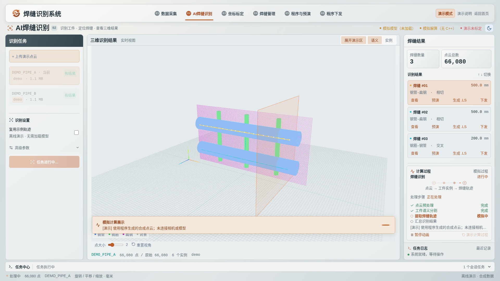

# Weld-Seam-Recognition-Feature-Demo
焊缝识别功能展示的前端设计

Next.js 前端源码位于 [`frontend/`](frontend/)。请先进入该目录再运行 npm 命令：

```sh
cd frontend
npm ci
npm run dev
```

完整的启动、后端代理、测试及已知联调限制见 [前端说明](frontend/README.md)，局域网部署见 [部署说明](frontend/DEPLOYMENT.md)。

离线展示可直接下载 [`demo/WELD-VISION.html`](demo/WELD-VISION.html)，用 Edge/Chrome 打开。只需分享这一个文件，无需安装依赖或连接后端。操作方法见 [使用说明](demo/使用说明.txt)。

配套可上传的演示点云见 [`demo/data/`](demo/data/)。下载 `.pcd` 后，可在最新版离线演示的“上传演示点云”入口导入；详细步骤见该目录的使用说明。

新版采用钛银铜橙风格，左上角统一为“焊缝识别系统”，工作流导航位于顶部。采集、识别、标定、程序生成与下发均配有处理过程示意，支持暂停动画与独立回放。真实模式的结果仍由后台确认。


